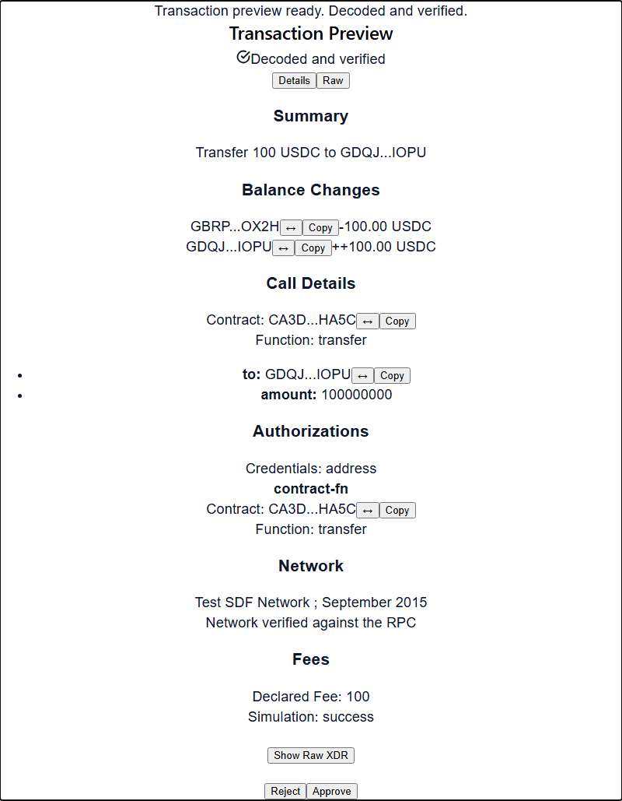
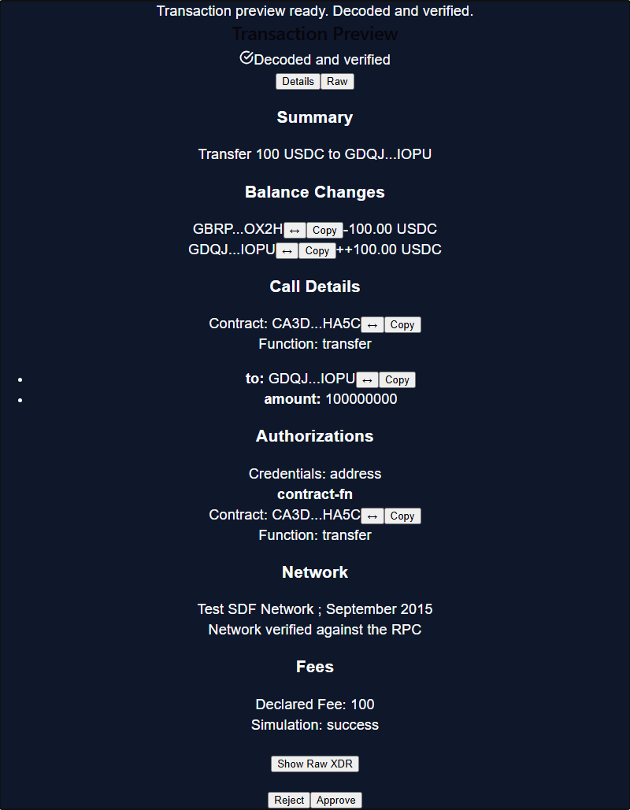
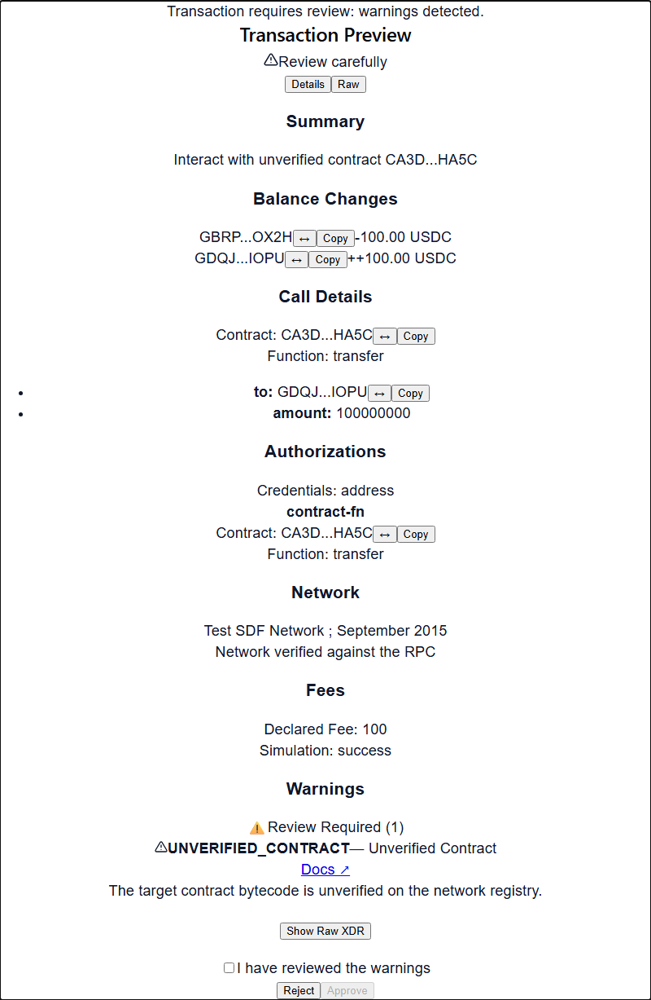
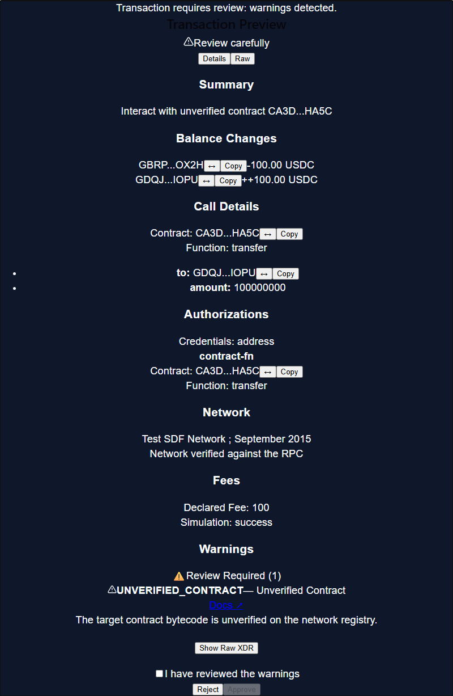
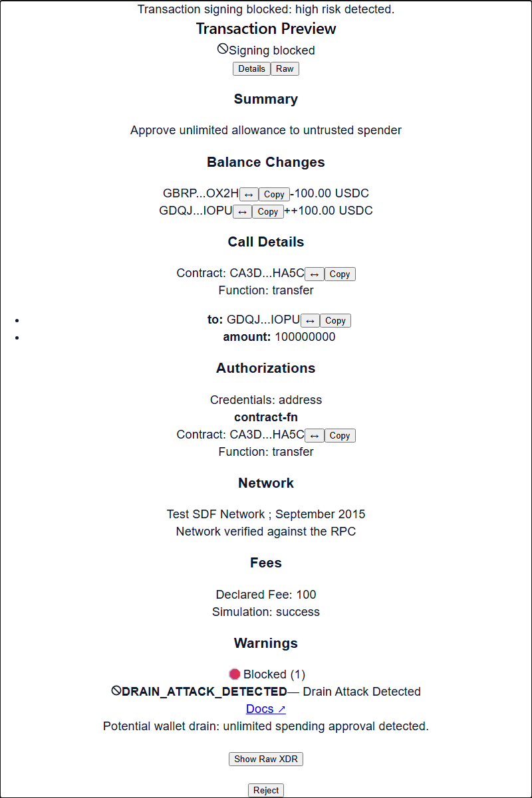
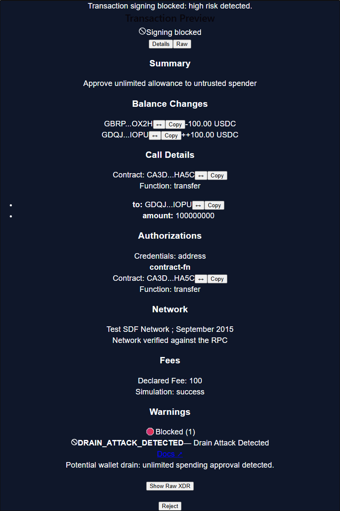
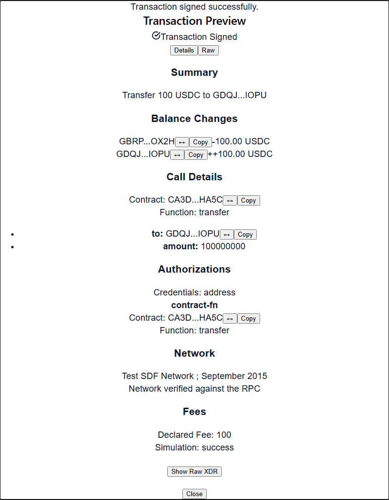
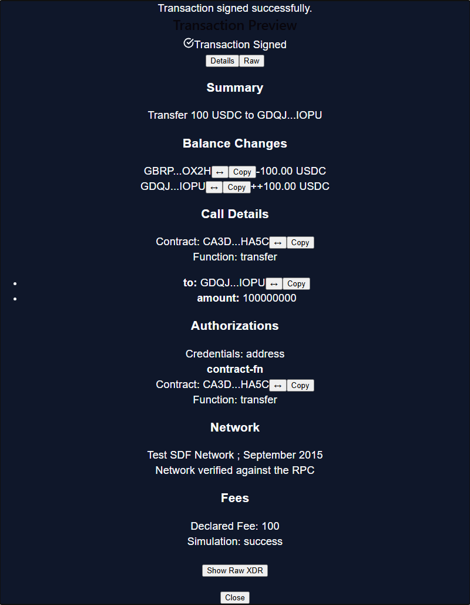

# Soroban Clear-Sign Kit - Frontend React Kit (`@clearsign/react`)

[](https://github.com/Soroban-Clear-Sign-Kit/SCSK-Frontend/actions/workflows/ci.yml)
[](LICENSE)
[](https://www.npmjs.com/package/@clearsign/react)

The Frontend package of the **Soroban Clear-Sign Kit (SCSK)** provides React context providers, hooks, presentation components, and wallet adapters for inspecting, simulating, and previewing Soroban and Stellar transactions with human-readable clarity and fail-closed security.

---

## Clean-Clone Walkthrough (Under 2 Minutes)

Get the interactive Testnet demo running locally from a clean clone:

```bash
# 1. Clone the repository
git clone https://github.com/Soroban-Clear-Sign-Kit/SCSK-Frontend.git
cd SCSK-Frontend

# 2. Run automated one-step setup (clones/builds backend core engine & installs dependencies)
pnpm run setup

# 3. Launch the interactive Testnet demo application
pnpm run dev
```

Open `http://localhost:5173` in your browser. You can immediately switch between all six modal states, toggle light and dark themes, inspect invocation trees, and sign real Soroban transactions with Freighter on Testnet.

---

## Installation

For existing React projects:

```bash
# Using npm
npm install @clearsign/react @clearsign/core @stellar/stellar-sdk

# Using pnpm
pnpm add @clearsign/react @clearsign/core @stellar/stellar-sdk

# Optional: Install wallet signing libraries if using prebuilt adapters
pnpm add @stellar/freighter-api
# or
pnpm add @creit.tech/stellar-wallets-kit
```

---

## Quick Start Running Against Soroban Testnet

Copy and paste this complete, working React component into your application:

```tsx
import React, { useState } from "react";
import { ClearSignModal, useClearSign } from "@clearsign/react";
import { freighterAdapter } from "@clearsign/react/adapters/freighter";
import "@clearsign/react/styles.css";

// Example Soroban Testnet SAC Token Transfer XDR (Sep-41 transfer invocation)
const TESTNET_SAMPLE_XDR =
  "AAAAAgAAAACKHGoJlvcC+kPnIKPhQhxFVRDWaCjhBF0UQT9QsWnc9QAAJxAATaEeAAAADQAAAAEAAAAAAAAAAAAAAAAAAAAAAAAAAAAAAAEAAAAAAAAAGAAAAAAAAAABAiMW1feUd3ZLcRjgE9iehksTK/dzffBv3Dfe+pgGyKUAAAAIdHJhbnNmZXIAAAADAAAAEgAAAAAAAAAAihxqCZb3AvpD5yCj4UIcRVUQ1mgo4QRdFEE/ULFp3PUAAAASAAAAAAAAAADkiCqJKF1eXt6Ug4Q+fYUVV4ccUdbV7BLYkoV8MT5LSQAAAAoAAAAAAAAAAAAAAAAAAABkAAAAAAAAAAAAAAAA";

export function SorobanTestnetSigner() {
  const [status, setStatus] = useState<string | null>(null);

  // Initialize ClearSign with Soroban Testnet RPC and Freighter wallet adapter
  const {
    open,
    preview,
    loading,
    error,
    isSigning,
    signedXdr,
    requestApproval,
    signTransaction,
    onApprove,
    onReject,
  } = useClearSign({
    rpcUrl: "https://soroban-testnet.stellar.org",
    networkPassphrase: "Test SDF Network ; September 2015",
    adapter: freighterAdapter(),
  });

  const handlePreviewAndSign = async () => {
    setStatus("Simulating transaction against Soroban Testnet...");
    try {
      // 1. requestApproval simulates transaction, opens ClearSignModal,
      // and resolves true ONLY if risk is 'ok' or user explicitly acknowledges 'review'
      const approved = await requestApproval(TESTNET_SAMPLE_XDR);
      if (!approved) {
        setStatus("Transaction rejected or blocked.");
        return;
      }

      // 2. Submit to connected wallet adapter (e.g. Freighter)
      setStatus("Awaiting Freighter wallet signature...");
      const signed = await signTransaction(TESTNET_SAMPLE_XDR);
      setStatus("Transaction signed successfully!");
      console.log("Signed Envelope XDR:", signed);
    } catch (err) {
      setStatus(`Failed: ${(err as Error).message}`);
    }
  };

  return (
    <div
      style={{ maxWidth: 640, margin: "2rem auto", fontFamily: "sans-serif" }}
    >
      <h2>Soroban Testnet Clear-Sign Demo</h2>
      <p>
        Simulate contract invocations and inspect state diffs before signing.
      </p>

      <button
        onClick={handlePreviewAndSign}
        disabled={loading || isSigning}
        style={{
          padding: "0.75rem 1.5rem",
          borderRadius: "6px",
          background: "#0284c7",
          color: "#fff",
          border: "none",
          cursor: "pointer",
          fontWeight: 600,
        }}
      >
        {loading
          ? "Simulating..."
          : isSigning
            ? "Signing in Freighter..."
            : "Preview & Sign Transaction"}
      </button>

      {status && <p style={{ marginTop: "1rem" }}>{status}</p>}
      {error && <p style={{ color: "#ef4444" }}>Error: {error.message}</p>}
      {signedXdr && (
        <p style={{ color: "#10b981" }}>
          Signed XDR: {signedXdr.slice(0, 32)}...
        </p>
      )}

      {/* Plug-and-play ClearSign dialog */}
      {open && (
        <ClearSignModal
          preview={preview}
          loading={loading}
          onApprove={onApprove}
          onReject={onReject}
        />
      )}
    </div>
  );
}
```

---

## Modal States (Visual Preview)

`ClearSignModal` natively renders 6 distinct visual states with dedicated WAI-ARIA semantics, live accessibility announcements, and fail-closed security gating:

| State       | Light Theme                                          | Dark Theme                                         | Purpose & Gating                                                                                                       |
| :---------- | :--------------------------------------------------- | :------------------------------------------------- | :--------------------------------------------------------------------------------------------------------------------- |
| **Ready**   |      |      | Simulation succeeded with risk `ok`. Immediate approval enabled. Full invocation tree and decoded arguments displayed. |
| **Loading** |  |  | `aria-busy="true"` dialog with spinner while Soroban RPC simulates transaction and generates preview.                  |
| **Review**  |    |    | Moderate risk detected. Approve button is gated until the user explicitly checks the acknowledgement checkbox.         |
| **Blocked** |  |  | Critical risk (e.g., unlimited allowance, unknown auth signer, simulation failure). Approve button is disabled.        |
| **Error**   |      |      | Network failure or malformed payload. Explains error details with action to dismiss.                                   |
| **Success** |  |  | Transaction signed successfully by wallet adapter with transaction hash confirmation.                                  |

---

## Props Reference

### `<ClearSignModal />`

| Prop                   | Type                           | Default                 | Description                                                                                     |
| :--------------------- | :----------------------------- | :---------------------- | :---------------------------------------------------------------------------------------------- |
| `preview`              | `ClearSignPreview \| null`     | `null`                  | The parsed and simulated Soroban transaction preview from `@clearsign/core`.                    |
| `loading`              | `boolean`                      | `false`                 | When `true`, displays a busy dialog with animated spinner while simulation completes.           |
| `onApprove`            | `() => void`                   | **Required**            | Invoked when the user clicks Approve. Enabled only for `ok` risk or checked `review` risk.      |
| `onReject`             | `() => void`                   | **Required**            | Invoked when the user clicks Reject, presses `Escape`, or closes the modal.                     |
| `theme`                | `"light" \| "dark" \| "auto"`  | `"auto"`                | Overrides application theme. Default `"auto"` automatically follows `prefers-color-scheme`.     |
| `messages`             | `Partial<ClearSignMessages>`   | `DEFAULT_MESSAGES`      | Dictionary of user-facing UI labels for internationalization or custom copy.                    |
| `stateDiffs`           | `StateDiffItem[]`              | `[]`                    | Optional custom ledger state diff entries to display in the balance modifications viewer.       |
| `className`            | `string`                       | `undefined`             | Custom CSS class applied to the dialog container.                                               |
| `defaultExpandedDepth` | `number`                       | `2`                     | Number of initial levels expanded in the contract invocation tree (levels > 2 collapse lazily). |
| `onNodeSelect`         | `(node: AuthTreeNode) => void` | `undefined`             | Callback fired when an invocation node is selected in the authorization tree.                   |
| `ariaLabel`            | `string`                       | `"Transaction Preview"` | Accessible label applied to the `<div role="dialog">` container.                                |

### `useClearSign(options)`

#### Options (`UseClearSignOptions`)

| Option                 | Type                                  | Default      | Description                                                                       |
| :--------------------- | :------------------------------------ | :----------- | :-------------------------------------------------------------------------------- |
| `rpcUrl`               | `string`                              | **Required** | The Soroban RPC endpoint URL (e.g. `https://soroban-testnet.stellar.org`).        |
| `networkPassphrase`    | `string`                              | **Required** | Stellar network passphrase (e.g. `"Test SDF Network ; September 2015"`).          |
| `adapter`              | `SignerAdapter`                       | `undefined`  | Wallet signing adapter (e.g. `freighterAdapter()`, `stellarWalletsKitAdapter()`). |
| `onSimulationComplete` | `(preview: ClearSignPreview) => void` | `undefined`  | Callback invoked immediately when Soroban simulation finishes.                    |

#### Return Object (`UseClearSignReturn`)

| Member            | Type                                | Description                                                                                             |
| :---------------- | :---------------------------------- | :------------------------------------------------------------------------------------------------------ |
| `open`            | `boolean`                           | Whether the ClearSign modal dialog is currently visible.                                                |
| `preview`         | `ClearSignPreview \| null`          | The generated preview data containing risk, summary, warnings, and invocations.                         |
| `loading`         | `boolean`                           | `true` while simulating transaction XDR against the Soroban RPC endpoint.                               |
| `error`           | `Error \| null`                     | Typed error if simulation or wallet signing fails (`WalletSigningError`, etc.).                         |
| `isSigning`       | `boolean`                           | `true` while awaiting signature response from the connected wallet adapter.                             |
| `signedXdr`       | `string \| null`                    | The signed transaction envelope XDR returned by the wallet adapter.                                     |
| `requestApproval` | `(xdr: string) => Promise<boolean>` | Builds preview, opens modal, and resolves `true` if approved (`ok` / `review`), or `false` if rejected. |
| `signTransaction` | `(xdr: string) => Promise<string>`  | Requests approval and submits approved XDR to the configured `adapter`.                                 |
| `onApprove`       | `() => void`                        | Approves current preview and resolves active approval promise with `true`.                              |
| `onReject`        | `() => void`                        | Rejects current preview and resolves active approval promise with `false`.                              |
| `reset`           | `() => void`                        | Resets all preview, loading, error, and signing states.                                                 |

### Guarding Existing Wallet Signers: `withClearSign`

```ts
import { withClearSign } from "@clearsign/react";

const safeSignTransaction = withClearSign(signTransactionFn, {
  requestApproval,
});
// Automatically simulates and prompts ClearSignModal before invoking signTransactionFn.
// Throws ClearSignRejectedError if rejected or blocked.
```

---

## Signer Adapters

Wallet signing is strictly decoupled from presentation components. You can connect any Stellar wallet or implement custom adapters.

### 1. Freighter Adapter

Imported via dedicated subpath export `@clearsign/react/adapters/freighter` (zero bundle overhead if unused):

```tsx
import { useClearSign } from "@clearsign/react";
import { freighterAdapter } from "@clearsign/react/adapters/freighter";

const { signTransaction } = useClearSign({
  rpcUrl: "https://soroban-testnet.stellar.org",
  networkPassphrase: "Test SDF Network ; September 2015",
  adapter: freighterAdapter(),
});
```

### 2. Stellar Wallets Kit Adapter

Supports 10+ hardware and software wallets via Creit Tech's `@creit.tech/stellar-wallets-kit`:

```tsx
import { useClearSign } from "@clearsign/react";
import { stellarWalletsKitAdapter } from "@clearsign/react/adapters/stellar-wallets-kit";
import {
  StellarWalletsKit,
  WalletNetwork,
} from "@creit.tech/stellar-wallets-kit";

const kit = new StellarWalletsKit({
  network: WalletNetwork.TESTNET,
  selectedWalletId: "albedo",
});

const { signTransaction } = useClearSign({
  rpcUrl: "https://soroban-testnet.stellar.org",
  networkPassphrase: "Test SDF Network ; September 2015",
  adapter: stellarWalletsKitAdapter(kit),
});
```

### 3. Custom Signer Adapter

Implement the `SignerAdapter` interface to support any custodial or non-custodial wallet:

```ts
import type { SignerAdapter } from "@clearsign/react";

export const myCustomAdapter: SignerAdapter = {
  name: "MyCustomSigner",
  async getAddress(): Promise<string> {
    return "GBRPYHIL2CI3FNQ4BXLFMNDLFJUNPU2HY3ZMFSHONUCEOASW7QC7OX2H";
  },
  async signTransaction(
    xdr: string,
    opts?: { networkPassphrase?: string },
  ): Promise<string> {
    // Perform signing logic with your key management system
    return signedXdr;
  },
};
```

---

## Theming & Design Tokens

Customize `@clearsign/react` without forking using CSS custom property tokens:

| Token                           | Default (Light) | Default (Dark) | Description                              |
| :------------------------------ | :-------------- | :------------- | :--------------------------------------- |
| `--clearsign-bg`                | `#ffffff`       | `#0f172a`      | Dialog surface background                |
| `--clearsign-border`            | `#e2e8f0`       | `#334155`      | Card borders and divider rules           |
| `--clearsign-text`              | `#0f172a`       | `#f8fafc`      | Primary body and heading text            |
| `--clearsign-text-muted`        | `#64748b`       | `#94a3b8`      | Monospace addresses and secondary labels |
| `--clearsign-btn-primary-bg`    | `#0284c7`       | `#38bdf8`      | Primary approve action button            |
| `--clearsign-btn-primary-text`  | `#ffffff`       | `#0f172a`      | Approve button text                      |
| `--clearsign-warn-blocked-bg`   | `#fef2f2`       | `#450a0a`      | Blocked risk card background             |
| `--clearsign-warn-blocked-text` | `#991b1b`       | `#fca5a5`      | Blocked risk card text                   |
| `--clearsign-warn-review-bg`    | `#fffbeb`       | `#451a03`      | Review risk card background              |
| `--clearsign-warn-review-text`  | `#92400e`       | `#fcd34d`      | Review risk card text                    |
| `--clearsign-radius-md`         | `8px`           | `8px`          | Dialog and card border radius            |

### Dark Mode Switching

By default, the modal adapts to the user's OS preference (`prefers-color-scheme: dark`). You can force a specific theme via the `theme` prop or `data-theme` attribute:

```tsx
<ClearSignModal theme="dark" preview={preview} ... />
// or
<div data-theme="dark">
  <ClearSignModal preview={preview} ... />
</div>
```

### Contrast & Internationalization (i18n)

- **WCAG 2.1 AA Compliant**: All text and controls guarantee `> 4.5:1` contrast for text and `> 3:1` for interactive controls in both themes.
- **RTL Layout Support**: Built using CSS logical properties (`margin-inline`, `padding-inline`) for right-to-left scripts (Arabic, Hebrew).
- **String Overrides**: Provide a custom `ClearSignProvider` or `messages` prop to translate any label into your target language. See [docs/THEMING_AND_I18N.md](docs/THEMING_AND_I18N.md).

---

## Accessibility (a11y)

The kit is engineered to strict WCAG 2.1 AA and WAI-ARIA standards:

- **Accessible Dialog**: Rendered as `<div role="dialog" aria-modal="true" aria-labelledby="clearsign-modal-title">`.
- **Focus Management**: Traps keyboard focus inside the dialog while open (Tab / Shift+Tab) and returns focus to the triggering element upon dismissal.
- **Keyboard Shortcuts**: Closes safely on `Escape`. Arrow keys switch between Details and Raw tabs and navigate tree nodes.
- **Live Announcements**: Critical security warnings are announced immediately to screen readers (`role="alert"`).
- **Zero Axe Violations**: Automated regression tests run `axe-core` across every modal state. See [docs/ACCESSIBILITY.md](docs/ACCESSIBILITY.md).

---

## Verification & Raw View

Inspect transaction details down to the byte:

- **Raw Envelope Tab**: View full Base64 envelope XDR and formatted decoded JSON with one-click copy buttons.
- **Address & Hash Reveal**: Defaults to middle-truncated format (`GBRP...OX2H`) with one-click expansion into grouped 4-character monospace chunks (`GBRP YHIL 2CI3...`).
- **State Diff Virtualization**: Paginates and virtualizes balance modifications, handling 1,000+ state diff entries with zero UI freeze. See [docs/VERIFICATION_AND_RAW.md](docs/VERIFICATION_AND_RAW.md).

---

## Vue 3 Companion Package (`@clearsign/vue`)

Prefer Vue? This monorepo includes an official Vue 3 kit located in the [`vue/`](vue/) directory:

- Full Vue 3 reactivity using Composition API composables (`useClearSign`, `withClearSign`).
- Native Vue 3 component (`ClearSignModal.vue`).
- Same fail-closed simulation and styling tokens (`@clearsign/vue/styles.css`).

See [`vue/README.md`](vue/README.md) for installation and usage.

---

## Testing & Quality

```bash
# Run all unit and SSR tests (209 tests)
pnpm test

# Run unit tests with strict coverage thresholds (>90% lines, stmts, branches)
pnpm run test:coverage

# Run Playwright visual regression snapshots (12 snapshots in light & dark)
pnpm run test:e2e

# Run publint and arethetypeswrong type checking audits
pnpm run check:package

# Verify size-limit bundle budgets
pnpm run check:size

# Test packed tarball installation in an isolated Vite application
pnpm run test:tarball
```

---

## Next.js & Server-Side Rendering (SSR)

`@clearsign/react` is verified with `react-dom/server` in pure Node.js environments and leads with `"use client";` directives in all distribution outputs. See [docs/NEXTJS_AND_SSR.md](docs/NEXTJS_AND_SSR.md) for Next.js App Router and Pages Router recipes.
